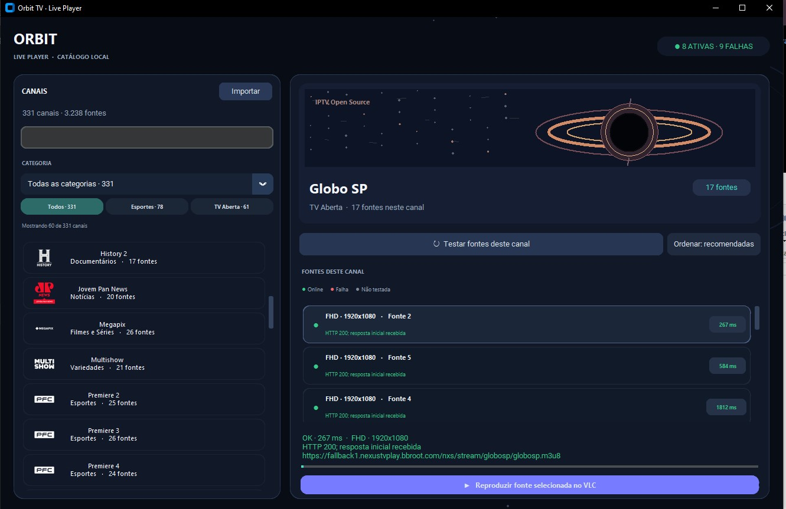

# Orbit TV

**Um reprodutor de IPTV para desktop, leve e desenvolvido em Python.**
<p align="center">
  
</p>

O Orbit TV começou como um projeto pessoal rápido, criado em cerca de 30 minutos antes de uma partida do Flamengo. O objetivo era simples: desenvolver uma aplicação para ver o jogo do Mengão , que permitisse navegar por fontes de IPTV disponíveis, verificar a conectividade e iniciar a reprodução, sem a necessidade de criar uma infraestrutura completa de streaming.

O que começou como um experimento prático evoluiu para um reprodutor desktop com recursos como busca de canais, filtros por categoria, diagnóstico de fontes e integração com o VLC.

## Funcionalidades

- **Catálogo de canais:** Navegue pelos canais, organizados por categorias.
- **Busca e filtros:** Encontre canais pelo nome e filtre-os por categoria.
- **Múltiplas fontes:** Visualize as fontes de streaming disponíveis para cada canal.
- **Diagnóstico de fontes:** Teste as fontes compatíveis, verificando o status da conexão, tempos de resposta (quando disponíveis) e eventuais motivos de falha.
- **Resultados em cache:** Reutilize resultados de diagnósticos recentes para evitar requisições de rede desnecessárias.
- **Importação de listas M3U:** Carregue listas de canais compatíveis a partir de arquivos locais.
- **Reprodução via VLC:** Abra o fluxo (stream) selecionado utilizando o reprodutor de mídia VLC instalado no seu sistema.
- **Interface escura:** Interface gráfica para desktop desenvolvida com a biblioteca CustomTkinter.

## Como funciona

O Orbit TV atua como uma interface desktop entre um catálogo de canais e um reprodutor de mídia externo.

1. **Carregar catálogo:** A aplicação lê o arquivo local `catalogo.txt` ou permite que o usuário selecione outro catálogo.
2. **Navegar pelos canais:** Pesquise pelo nome, explore as categorias e selecione um canal.
3. **Analisar fontes:** Visualize as fontes disponíveis e execute testes de conectividade (quando suportados).
4. **Selecionar uma fonte:** Escolha uma fonte com base nos resultados dos diagnósticos.
5. **Iniciar reprodução:** O Orbit TV abre o VLC com a URL do fluxo selecionado.
6. **Solucionar problemas:** Os resultados de conectividade e os diagnósticos do VLC ajudam a identificar falhas comuns na reprodução.

A aplicação não hospeda fluxos de vídeo. A reprodução depende da fonte selecionada, da conectividade com a rede e de eventuais requisitos de acesso impostos pelo provedor da fonte. ## Pilha Tecnológica

- Python
- CustomTkinter e Tkinter
- VLC media player
- Bibliotecas padrão do Python para redes e concorrência
- Pillow (para processamento de imagens, opcional)

## Requisitos

- Recomenda-se o uso do Python 3.10 ou superior.
- VLC media player instalado separadamente.
- Um catálogo ou lista de reprodução (playlist) de IPTV compatível.
- Acesso à internet para transmissões online e carregamento de logotipos de canais.

## Primeiros Passos

Instale as dependências do Python:

```bash
python -m pip install customtkinter pillow
```

Instale o VLC a partir do site oficial:

https://www.videolan.org/vlc/

Coloque o arquivo `orbit_tv_desktop.py` e o seu `catalogo.txt` no mesmo diretório e, em seguida, execute:

```bash
python orbit_tv_desktop.py
```

Também é possível empacotar a aplicação em um executável para Windows, desde que as dependências necessárias e a integração com o VLC estejam configuradas corretamente.

## Formato do Catálogo

O Orbit TV suporta um catálogo baseado em texto, contendo entradas para nomes de canais, categorias, logotipos, fontes de transmissão e metadados opcionais (como qualidade e cabeçalhos HTTP).

O catálogo utilizado deve conter apenas fontes que você tenha autorização para acessar e redistribuir.

## Objetivos do Projeto

O Orbit TV é um experimento prático em desenvolvimento de interfaces (UI) para desktop, integração com reprodutores de mídia, diagnóstico de rede e gerenciamento local de listas de reprodução.

O projeto poderá evoluir com melhorias no gerenciamento de catálogos, fluxos de reprodução, relatórios de erros e processos de empacotamento.

## Aviso Legal

O Orbit TV é uma interface para reprodução de mídia; ele não fornece conteúdo de streaming. É responsabilidade do usuário garantir que as transmissões, listas de reprodução, logotipos e outros recursos utilizados sejam acessíveis legalmente e que possuam as devidas permissões.

Este projeto não garante a disponibilidade, a qualidade ou a ausência de anúncios em transmissões de terceiros.

O VLC é um projeto independente e não está incluído neste repositório, a menos que seja explicitamente indicado o contrário.
